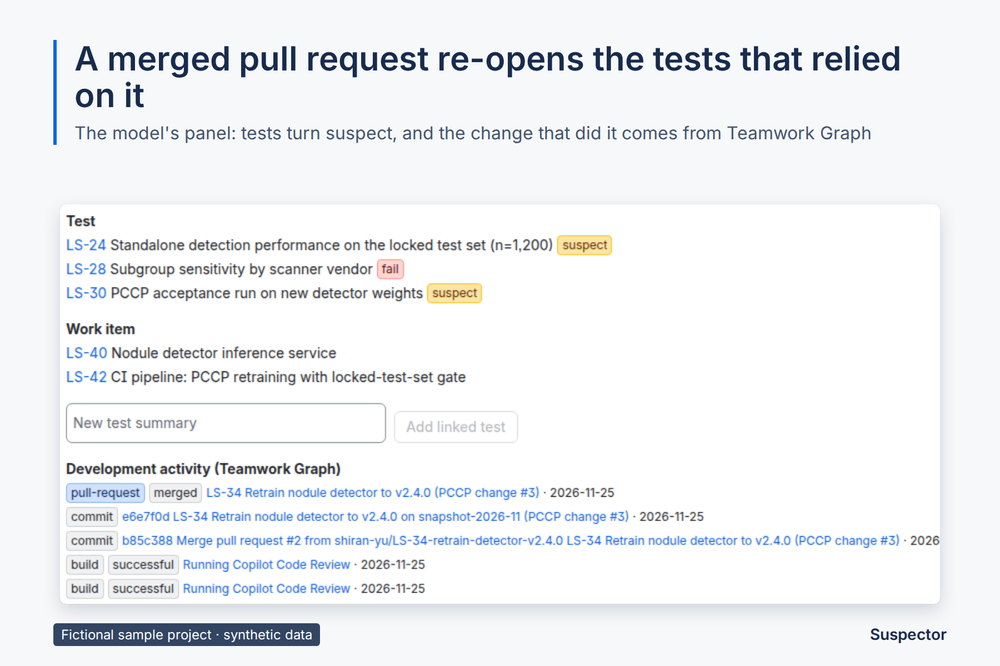

# Suspector support

Suspector is a free Atlassian Forge app built for Codegeist 2026 by Shiran Yu (independent developer).

## What it is, for whom, why it matters
Teams that build medical-device software keep their design-control trace (needs, requirements, hazards, risk
controls, tests, AI models, SOUP) in Jira. When code, a model or a requirement changes, the tests that verified the
old version stop proving anything, and today someone finds out by spreadsheet before an audit. Suspector reads the
Jira project as an IEC 62304 / ISO 14971 trace, re-opens exactly the tests a change invalidated (requirement edits,
merged pull requests, new AI model weights, SOUP upgrades), says why, and checks a release before it ships.

## Built for Codegeist 2026 (Apps for Specialized Industries)
| Bonus prize | Manifest module | What it does | Where to see it |
|---|---|---|---|
| Best Agents | `rovo:agent` `suspector-audit-prep` + `rovo:skill` `iec62304-gap-review`, 13 `action`s | Answers from the trace (what to re-run, which hazard to reassess); asks the team whether a model change is within the FDA PCCP instead of guessing; drafts and links a missing test | Video 1:20–1:58; Rovo chat → Suspector Audit Prep |
| Best app with Atlassian MCP | `rovo:mcp` (the same 13 actions) | A coding agent (e.g. Claude Code, signed in once with OAuth) that runs the retraining records test results against a model version and asks what a change would re-open | Video 1:58–2:25; [MCP skill](skills/suspector-mcp/SKILL.md) |
| Best Teamwork Graph integration | Teamwork Graph API (pull requests, commits, builds, deployments per work item) | A merged pull request or deployment on a traced item re-opens the tests that verified it, naming the change | Video 0:54–1:20; the Suspector project page's "re-opened by changes" call-out |

Runs on Atlassian: Forge functions, KVS and Jira/Confluence APIs only; no servers of our own.

## Get help
- **Questions and bugs:** open an issue at https://github.com/shiran-yu/suspector/issues. Please include your site URL, the Jira project key, the issue key
  if one issue is affected, and what you expected to see.
- **Security reports:** please report privately via https://github.com/shiran-yu/suspector/security/advisories/new (do not open a public issue).
- Support is best effort; we aim to reply within two working days (UK time).

## Quick start
1. Install Suspector on your site (Jira required; Confluence optional for snapshots).
2. Open a Jira project → the **Suspector** tab → **Load AI radiology sample (LungScout CT)**, or classify your
   own work items with **Suspector** in each work item's details column (right-hand side).
3. Optional: Rovo chat → **Suspector Audit Prep**; MCP clients after an admin enables Suspector's tools in
   admin.atlassian.com → Apps → Sites → your site → Connected apps → Suspector. For your own agent (IDE or
   terminal; Forge MCP tools need a one-time OAuth sign-in, so no unattended CI job), add the open-source skill [skills/suspector-mcp/SKILL.md](skills/suspector-mcp/SKILL.md) (MIT).

## Common questions
- **My issues do not appear.** Suspector reads issues labelled `suspector` or `suspector-<kind>` (for example `suspector-requirement`), issues of a mapped type (for example
  User Need, Stakeholder Need, Requirement, System Requirement, Hazard, Risk Control, Test Case, Verification, SOUP,
  AI Model), or work items classified with Suspector in their details column.
- **No merged pull requests are shown.** Connect GitHub or Bitbucket to the site (e.g. GitHub for Atlassian);
  Suspector reads that activity through the Teamwork Graph.
- **The Suspector Audit Prep agent is missing in Rovo.** Rovo must be active on the site (Rovo chat in the top bar). Without it, the
  Gaps and Release tabs and "What must be re-verified if this changes?" on a work item give the same answers.
- **No Confluence space to publish to.** The snapshot needs Confluence with at least one space; create one, then
  reload the list on the Readiness and snapshot tab.
- **Does Suspector certify compliance?** No. It checks traceability against IEC 62304:2006+A1:2015 and
  ISO 14971:2019 and supports your quality team; it is not a conformity determination, and release decisions stay
  with your qualified people.

## Tested on requirements we did not write
The Open Patient-Controlled Analgesia Infusion Pump System Requirements 1.0.0 (SAnToS TR 2018-4-1; SAnToS Lab,
Kansas State University; first draft by Brian R. Larson), simulated requirements for a mock infusion pump published
for research and standards development, are licensed CC BY-SA 3.0 (https://creativecommons.org/licenses/by-sa/3.0/);
source: http://pub.santoslab.org/open-pca-pump/artifacts/Open-PCA-Pump-Requirements.pdf. We imported them into a Jira
project by the document's own citations: 8 goals as Stakeholder Needs, 24 exception cases as Hazards (our mapping)
and 143 requirements as System Requirements, with plain Jira links. The findings concern citations as written, not
content. Suspector reported, among others: no requirement reaches goals G6 and G7 (the authentication and
confidentiality requirements R8.1.0 and R8.2.0 cite use case UC1 or nothing); 70 of the 143 requirements reach no
goal (43 cite nothing, 23 a standard, a paper, "many EC" or "all UC and EC", which our import does not link, 2 the
placeholder "FDA ??", 1 use case UC7, which lists no goals, 1 "EC23b §4.2.22", whose section is EC22's). Readiness is
10% because only traced goals (5 of 8) can score without tests or risk estimates; this is not a judgement of the
document. Adapted by us; not affiliated with or endorsed by its authors or Kansas State University.

## Limits
- One Jira project per analysis; up to 2,000 traced issues per load. Suspector says when a project or a fix version
  reaches that limit, and a release check is then not READY.
- Development activity (Teamwork Graph) is read for up to 100 traced items per analysis (in a release check the
  release's scope first, then AI models, linked work items, requirements, controls, SOUP) and up to 25 artifacts per
  item. The dashboard says when either cap applied. A release check withholds READY if its own scope was not fully
  read, if Teamwork Graph returned an error, or if the project's issue types could not be read. When activity was not
  read in full, the trace-matrix CSV marks passing, non-suspect results `unknown` instead of `yes` in its Current column.
- The release check reads up to 100 open Bugs (issue type Bug) and lists those outside the fix version as known
  residual anomalies (IEC 62304 §5.8.2), not blocking; it cannot tell whether each was evaluated (§5.8.3). A project
  without a Bug issue type gets a note instead.
- Teamwork Graph has no merge time: a pull request's change time is the last-update time Suspector first read for it.
- On large projects Teamwork Graph can rate-limit a second read within about a minute; Suspector then says how many
  items it checked (seen on a 798-issue test project).

## Uninstall
Site admins: Jira → Apps → Manage apps → Suspector → Uninstall. See the privacy policy for what remains.

## Disclaimer
Suspector is a traceability and documentation aid for teams that build medical-device software. It is not a
medical device and is not intended for diagnosis, treatment or any clinical decision. It does not process patient
data. Readiness scores, gaps and findings are indicators for qualified people to review. They are not a
determination of conformity with IEC 62304, ISO 14971, ISO 13485, 21 CFR Part 820 or any other standard or
regulation, and not regulatory or legal advice. Clause numbers refer to IEC 62304:2006+A1:2015 and ISO 14971:2019;
standard text is not reproduced, so use your licensed copies. FDA guidance is summarised in our own words; guidance
is non-binding, so check the current version on fda.gov. If you use this software in your quality management
system, validate it for your intended use (ISO 13485:2016 clause 4.1.6; FDA Computer Software Assurance guidance).
LungScout CT and QuantMap are fictional products with synthetic data; the Open PCA requirements are credited above.
Not affiliated with or endorsed by IEC, ISO, FDA, MHRA, Kansas State University, Atlassian, GitHub or Anthropic.

Privacy policy: [PRIVACY.md](PRIVACY.md) · Terms of use: [TERMS.md](TERMS.md)
